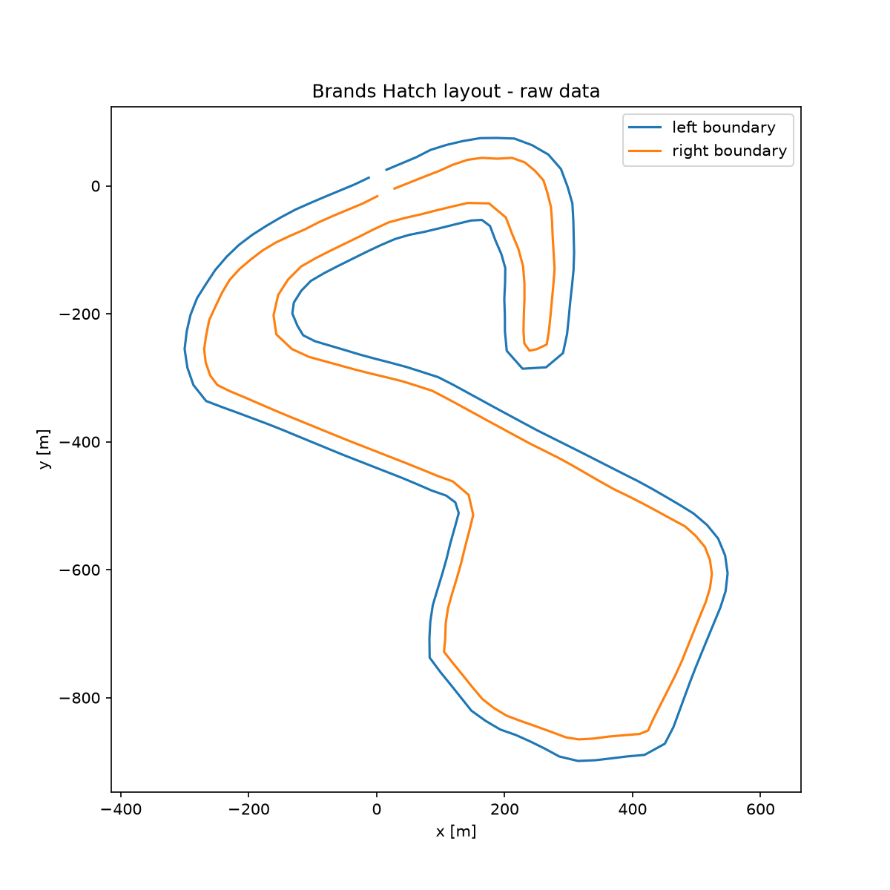
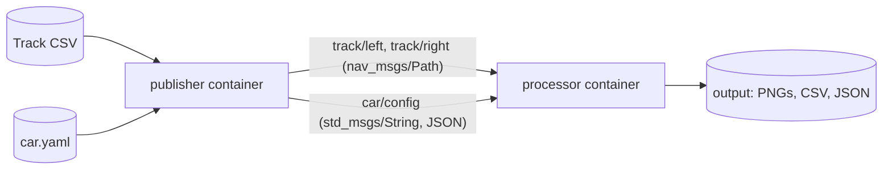
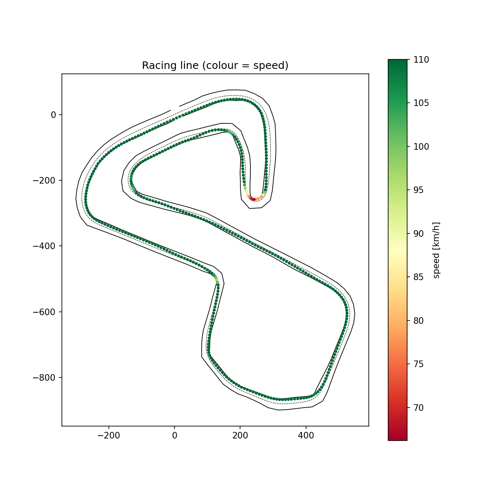
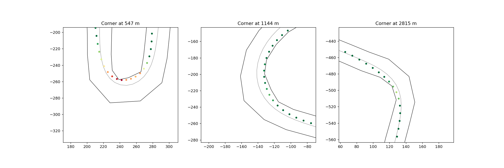
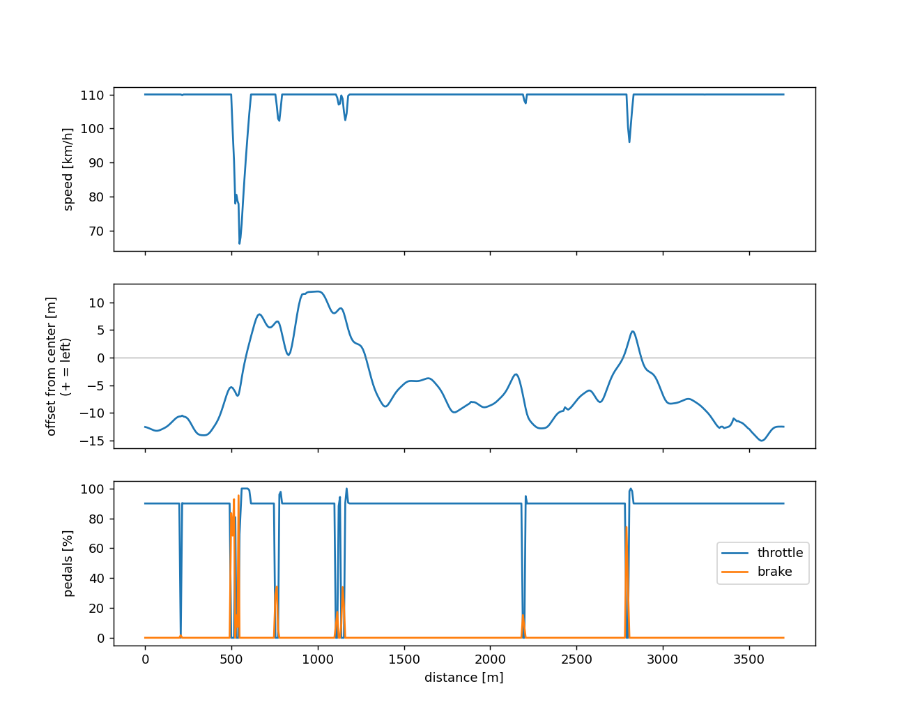

# Optimal Racing Line Planner – BGRacing Autonomous Home Assignment

A small ROS 2 pipeline, running in two Docker containers, that takes the boundaries of the
Brands Hatch circuit and a few simple car settings and calculates **the lane on the track that the car
should drive** to get the shortest lap time. For every point of the track it also gives the
speed and the throttle / brake demand.

## 1. Overview

| Requirement | How it is met |
|---|---|
| Two Docker containers | `publisher` (data source) and `processor` (computation) |
| Ubuntu 24.04 + ROS 2 Jazzy | Both images are based on `ros:jazzy` |
| Python 3.12 | System Python of the image |
| Reproducible | `docker compose up --build --abort-on-container-exit` |

## 2. Dataset

`data/BrandsHatchLayout.csv` (provided with the assignment): the left and right boundary of
the Brands Hatch Grand Prix circuit.

| Property | Value |
|---|---|
| Columns | `x`, `y`, `side` (`left` / `right`) |
| Rows | 314 (157 per side, the first row of each side is empty and is dropped) |
| Valid points | 156 per side |
| Coordinates | Local (x, y) positions, not GPS; assumed to be in meters |
| Left boundary length | ≈ 3,980 m |
| Right boundary length | ≈ 3,789 m |
| Track width (distance between matching left/right points) | 22.8 m – 35.7 m, mean 27.6 m |
| Spacing between points | ≈ 12 – 37 m |

The track is a closed loop. The last point is not connected to the first one in the file
(≈ 30 m gap), so the code closes the loop itself.



*Note: the track is wider than a real circuit. This is a property of the dataset.*

## 3. Task

**Input:** the track boundaries and the car config (`config/car.yaml`): top speed, maximum
acceleration, maximum braking, tire type and surface (dry / wet).

**Output:**
- the best racing line, given as an offset from the center of the track at every point
  (positive = left, negative = right)
- optimal speed at every point
- optimal throttle (0–100 %) and brake (0–100 %) demand at every point
- lap time of the racing line compared to the center line
- images (whole track and zoomed corners) and a CSV table

The line always stays at least **1 m** from the track edges (`margin_m`).

## 4. Pipeline



**Publisher** (`publisher/publisher_node.py`) reads the CSV and the car config and publishes
them once. **Processor** (`processor/processor_node.py`) subscribes to the three topics,
waits until all arrived, computes the racing line and saves the results.
All topics use QoS `RELIABLE` + `TRANSIENT_LOCAL`, so the processor gets the data even if it
starts after the publisher.

| Topic | Type | Content |
|---|---|---|
| `track/left` | `nav_msgs/Path` | left boundary points |
| `track/right` | `nav_msgs/Path` | right boundary points |
| `car/config` | `std_msgs/String` | car config as JSON |

## 5. Algorithm

1. **Corridor.** Match left and right points, take their average as the center line
   (smoothed), and compute for every point the direction to the left. Walking from the center
   in small steps to each side, find how far the line may move while staying 1 m from the walls
   (nearest-wall distance with a `cKDTree`).
2. **A racing line is a list of offsets**, one per point: how many meters to move from the
   center to the left or right.
3. **Lap simulation** (`speed_profile`). Gives every candidate line a lap time:
   - corner limit: `v = sqrt(grip · g / curvature)`
   - forward pass: speed can not grow faster than the maximum acceleration
   - backward pass: speed must allow braking in time for the next corner
   - lap time = sum of `distance / average speed`
4. **Search** (`optimize_line`). Hill climbing: start at the center line, change some offsets
   randomly, keep the change only if the lap time improves, repeat 10,000 times with
   shrinking steps.
5. **Pedals** (`pedal_commands`). The acceleration is calculated from the speed change between
   points. While speeding up, the throttle goes from a holding level up to 100 %. The holding
   level grows linearly with speed (0 % at standstill, 90 % at top speed) and replaces the air
   drag, which is not modelled. While braking, the throttle is 0 % and the brake is the
   required deceleration divided by the maximum braking.

## 6. Code overview

| File | Function | What it does |
|---|---|---|
| `processor/racing_line.py` | `resample` | Picks evenly spaced points from a closed polyline |
| | `smooth` | Rounds corners by averaging each point with its neighbours |
| | `make_corridor` | Center line, left direction and allowed offsets (safety margin) |
| | `make_line` | Builds a line from offsets |
| | `curvature` | Sharpness of the turn from 3 neighbouring points |
| | `speed_profile` | Speed at every point and lap time |
| | `pedal_commands` | Throttle and brake percent |
| | `offsets_from_controls` | Spreads 60 control values smoothly over all points |
| | `optimize_line` | Hill climbing search for the best offsets |
| `processor/outputs.py` | `save_outputs` | Saves the images, CSV and JSON |
| | `draw_track`, `sharpest_corners` | Helpers for the plots |
| `processor/processor_node.py` | `RacingLineProcessor` | ROS node: collects data, runs the pipeline |
| `publisher/publisher_node.py` | `DataPublisher` | ROS node: reads files, publishes data |
| `explore.py` | | Dataset statistics and the raw track image |

## 7. Car settings and assumptions

`config/car.yaml`:

| Setting | Value | Note |
|---|---|---|
| Top speed | 110 km/h | assumed |
| Max acceleration | 5 m/s² | assumed |
| Max braking | 12 m/s² | assumed |
| Hold throttle at top speed | 90 % | assumed |
| Tire | medium | soft / medium / hard / wet |
| Surface | dry | dry / wet |
| Safety margin | 1 m | distance from the track edges |

**All car values and tire grip coefficients are assumptions, not measured data.**
The model is simplified on purpose: no air drag, no downforce, no weight transfer, no tire
temperature, and a 2D track without elevation.

## 8. Results

Medium tires, dry track:

| | Lap time |
|---|---|
| Center line | 127.2 s |
| Racing line | 122.7 s (≈ 3.5 % faster) |

- Line length: ≈ 3,710 m (center line ≈ 3,800 m)
- Speed: 66.2 – 110 km/h
- Minimum distance to the track edge: 1.03 m





Effect of the tire (lap time of the racing line, in seconds):

| Tire | Dry | Wet |
|---|---|---|
| Soft | 122.5 | 128.2 |
| Medium | 122.7 | 129.1 |
| Hard | 123.1 | 131.4 |
| Wet | 126.2 | 125.3 |

Slick tires are fastest on a dry track; the wet tire is the fastest on a wet track.

All results are saved to `output/` (`results.json`, `racing_line.csv` and the images).

## 9. How to run

Requirements: Docker Desktop.

```bash
git clone <repo-url>
cd <repo-folder>
docker compose up --build --abort-on-container-exit
```

The first build takes a few minutes (downloading the ROS image and installing packages).
After that, a run takes about 20–30 seconds, depending on the machine.
The results appear in `output/`.
To change the car, edit `config/car.yaml` and run again (no rebuild needed for the config).
Stop and clean up with `docker compose down`.

## 10. Limitations and future work

- The model is simple (see Section 7). Adding air drag, downforce and a real motor model
  would make the speeds more realistic.
- Hill climbing finds a good line, not a guaranteed best one.
- The line uses most of the width, because the track in the dataset is wide.
- Future work: feed the planner with boundaries estimated from cone detection (LiDAR /
  camera), add a controller that follows the line, and update the car parameters from real
  test drives.

## 11. Tools

Python, NumPy, SciPy, Matplotlib, ROS 2 Jazzy, Docker. 
During development' I used LLM's (Claude\Gemini) for assistance to brainstorm the ROS 2 architecture, get thechnical explanations and drafts of standard code.


## 12. Run

Update parameters and run program -
docker compose up --abort-on-container-exit

after finished - 
docker compose down